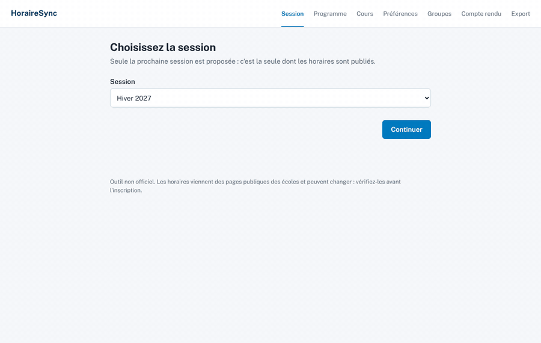
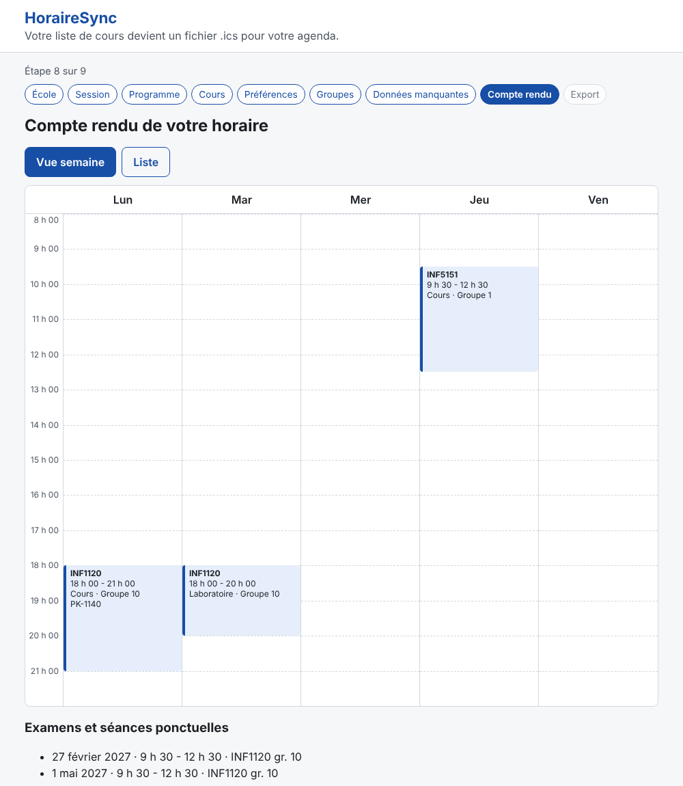
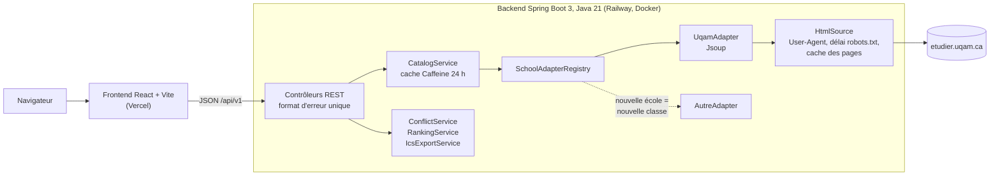

# HoraireSync

[](https://github.com/Chakib-Selhi/HoraireSync/actions/workflows/ci.yml)

**Français** · [English](#english)

HoraireSync transforme une liste de cours universitaires en fichier `.ics` importable dans Apple Calendar, Google Calendar ou Outlook. On choisit son école, sa session et ses cours ; l'application récupère les groupes publiés, les classe selon ses préférences, détecte les conflits et génère l'horaire de la session.

**Démo :** [horairesync.vercel.app](https://horairesync.vercel.app) · **API :** [backend-production-68f55.up.railway.app/api/v1/schools](https://backend-production-68f55.up.railway.app/api/v1/schools)



## Problème résolu

À chaque session, un étudiant compare les groupes de 4 ou 5 cours sur plusieurs pages, repère les conflits à la main, puis recopie chaque séance dans son agenda. C'est long, répétitif et source d'erreurs. HoraireSync fait ce travail en quelques minutes et produit un fichier standard (RFC 5545) qui s'importe en une fois.

Contrainte de conception : **aucune IA**. Toute l'extraction est déterministe (Jsoup), et une donnée introuvable n'est jamais devinée : elle reste vide, est signalée « Information non disponible » et l'utilisateur peut la saisir.

## Fonctionnalités

- UQAM prise en charge automatiquement (horaires, enseignants, modes, campus, examens, congés et relâche).
- Mode manuel pour toute autre école : on saisit ses cours et on obtient quand même le fichier `.ics`.
- Préférences facultatives (jour ou soir, mode, campus, jours libres) et classement des groupes avec le détail de chaque critère.
- Détection des conflits entre séances hebdomadaires et examens.
- Compte rendu en vue semaine et en liste, export bloqué tant qu'une donnée indispensable manque.
- Fichier `.ics` : séances récurrentes jusqu'à la fin de session, congés exclus, fuseau `America/Toronto`, UID stables.



## Architecture



Le frontend ne parle qu'à l'API. Seul l'adaptateur connaît le HTML de l'école : ajouter une école ne touche ni les services ni le frontend. Les routes d'horaire (`/schedule/*`) sont sans état : le frontend renvoie les groupes qu'il détient, valeurs saisies à la main comprises, ce qui fait aussi fonctionner le mode manuel.

| Route | Rôle |
| --- | --- |
| `GET /api/v1/schools` | Écoles et indicateur de prise en charge |
| `GET /api/v1/schools/{id}/terms` | Sessions et leurs dates |
| `GET /api/v1/schools/{id}/programs?q=` | Recherche de programmes |
| `GET /api/v1/schools/{id}/programs/{code}/courses` | Cours d'un programme |
| `GET /api/v1/schools/{id}/terms/{term}/courses/{code}/sections` | Cours et groupes pour une session |
| `POST /api/v1/schedule/conflicts` | Conflits entre groupes choisis |
| `POST /api/v1/schedule/rank` | Score de chaque groupe selon les préférences |
| `POST /api/v1/schedule/export` | Fichier `text/calendar` |

Erreurs : `{ "code": "SOURCE_UNAVAILABLE", "message": "..." }` avec les codes `SCHOOL_NOT_SUPPORTED`, `PROGRAM_NOT_FOUND`, `COURSE_NOT_FOUND`, `SOURCE_UNAVAILABLE`, `PARSING_FAILED`, `INVALID_SCHEDULE`, `INVALID_REQUEST`, `INTERNAL_ERROR`.

## Choix techniques

| Choix | Pourquoi |
| --- | --- |
| **Patron adaptateur + registre Spring** | Chaque école est un `@Component` qui implémente `SchoolAdapter` ; le registre les indexe par `schoolId`. Ajouter une école = ajouter une classe. |
| **Jsoup, sans navigateur headless** | L'analyse de la phase 0 a montré que les groupes sont rendus côté serveur ([docs/phase0-uqam.md](docs/phase0-uqam.md)). Plus simple, plus rapide, plus léger pour le site source. |
| **`HtmlSource` derrière une interface** | Un seul point d'accès au réseau : User-Agent, `Crawl-delay: 10` de robots.txt, cache 24 h. Les tests le remplacent par des pages enregistrées et ne touchent jamais le réseau. |
| **Deux niveaux de cache Caffeine** | Pages brutes (une page de cours sert toutes les sessions) et résultats analysés (réponse en quelques millisecondes). |
| **« Ne jamais inventer »** | Valeur absente = `null` + entrée dans `missingFields` ; structure inattendue = `PARSING_FAILED` plutôt que des données fausses. |
| **ical4j plutôt que Biweekly** | Biweekly doit télécharger le bloc VTIMEZONE (tzurl.org) ; ical4j fonctionne hors ligne et sert aussi à relire le fichier dans les tests. |
| **VTIMEZONE compact** | Généré à partir des règles du JDK (2 blocs) au lieu des 20 blocs historiques fournis par ical4j, comme le fait Google Calendar. |
| **Pas de `METHOD:PUBLISH`** | Cette propriété iTIP exige un `ORGANIZER` ; sans elle le fichier est un calendrier RFC 5545 valide selon le validateur ical4j. |
| **Frontend : un `useReducer`, pas de Redux ni de routeur** | Parcours linéaire ; l'état et les règles (champs manquants, blocage de l'export, vue semaine) sont des fonctions pures testées sans React. |
| **Textes centralisés (`fr.js`)** | Version anglaise future = un fichier de plus. Les codes d'erreur de l'API sont traduits par l'interface. |

## Lancer le projet

Prérequis : Java 21 et Node 22 (macOS : `brew install openjdk@21 node`).

```bash
# Backend : http://localhost:8080/api/v1
cd backend
./mvnw spring-boot:run

# Frontend : http://localhost:5173 (dans un autre terminal ; /api est redirigé vers le backend)
cd frontend
npm install
npm run dev
```

Tests :

```bash
cd backend && ./mvnw verify     # JUnit 5, Mockito, Spring Boot Test, couverture JaCoCo >= 70 % (services et adaptateurs)
cd frontend && npm test         # Vitest + Testing Library
```

Le test d'export relit le fichier généré avec le parseur ical4j : il compte les occurrences (14 lundis pour INF1120 gr. 1 en Hiver 2027, relâche et congé exclus), vérifie l'heure après le passage à l'heure avancée et passe le validateur ical4j.

## Déploiement

| Partie | Hébergeur | Configuration |
| --- | --- | --- |
| Backend | Railway (image Docker) | Service relié au dépôt : dossier racine `/backend`, `Dockerfile`, vérification de santé `/api/v1/schools`, redéploiement à chaque push touchant `backend/`. Variables : `CORS_ALLOWED_ORIGINS` (adresse Vercel, motifs acceptés pour les aperçus) et `PORT=8080`. |
| Frontend | Vercel | `frontend/vercel.json`, dossier racine `frontend`, redéploiement à chaque push. Variable `VITE_API_URL` = adresse Railway. |
| CI | GitHub Actions | `.github/workflows/ci.yml` : tests backend et frontend, build de l'image Docker. |

## Ajouter une école

1. Enregistrer 2 ou 3 pages publiques dans `backend/src/test/resources/fixtures/<ecole>/`.
2. Créer `backend/src/main/java/com/horairesync/adapter/<ecole>/<Ecole>Adapter.java` qui implémente `SchoolAdapter` et porte `@Component`. Utiliser `HtmlSource` pour télécharger les pages.
3. Respecter la règle : champ introuvable = `null` + nom dans `missingFields` ; structure inattendue = `PARSING_FAILED`.
4. Ajouter le délai de robots.txt de l'hôte dans `horairesync.http.crawl-delays` (`application.yml`) et retirer l'école de `unsupported-schools`.
5. Écrire les tests sur les fixtures (voir `UqamAdapterTest`).

Le registre découvre la classe au démarrage ; aucun service ni écran à modifier.

## Limites connues

- Une seule école automatisée (UQAM). Les autres passent par la saisie manuelle.
- L'UQAM ne publie pas le local des séances (seulement le campus) ni celui des examens ; le local n'est lu que si une remarque le donne explicitement.
- La fin de session publiée est parfois ambiguë (« 23 avril ou 30 avril ou 2 mai ») : on utilise les dates « Du … au … » de chaque séance.
- La semaine de relâche dépend de la faculté : elle est exclue par défaut et l'utilisateur peut la garder.
- Si le site de l'UQAM change de structure, l'adaptateur renvoie `PARSING_FAILED` et il faut le mettre à jour.
- Premier chargement d'un cours jusqu'à 10 s quand plusieurs pages sont demandées d'affilée (délai de robots.txt), puis instantané grâce au cache.
- Cache en mémoire : il repart à vide à chaque redémarrage du backend.
- Pas encore de sauvegarde dans le navigateur ni de générateur de combinaisons sans conflit (prévu en V1.1).
- Import vérifié automatiquement par relecture du fichier ; la liste de vérification manuelle des 3 agendas est dans [docs/import-checklist.md](docs/import-checklist.md).

## Avis

Outil non officiel, sans lien avec l'UQAM. Les données viennent des pages publiques d'etudier.uqam.ca, lues en respectant robots.txt, avec un cache et peu de requêtes. Vérifiez votre horaire officiel dans le portail de votre école.

---

<a id="english"></a>

# HoraireSync (English)

[Français](#horairesync) · **English**

HoraireSync turns a list of university courses into an `.ics` file for Apple Calendar, Google Calendar or Outlook. Pick a school, a term and courses; the app reads the published sections, ranks them against your preferences, detects conflicts and generates the term schedule. The interface is in French; texts are centralized for a future English version.

**Demo:** [horairesync.vercel.app](https://horairesync.vercel.app) · **API:** [backend-production-68f55.up.railway.app/api/v1/schools](https://backend-production-68f55.up.railway.app/api/v1/schools)

## Problem

Every term, students compare sections of 4 or 5 courses across several pages, spot conflicts by hand, then copy every class into their calendar. HoraireSync does it in minutes and outputs a standard RFC 5545 file imported in one go.

Design constraint: **no AI**. Extraction is deterministic (Jsoup) and missing data is never guessed: it stays empty, is flagged "Information non disponible" and the user can fill it in.

## Features

- UQAM read automatically (sections, instructors, delivery modes, campuses, exams, holidays and reading week).
- Manual mode for any other school.
- Optional preferences (day or evening, mode, campus, free days) with per-criterion ranking.
- Conflict detection between weekly meetings and exams.
- Weekly grid and list review; export blocked while required data is missing.
- `.ics` with weekly recurrences until the end of term, excluded holidays, `America/Toronto` time zone and stable UIDs.

## Architecture

See the diagram above. The frontend only talks to the REST API; only the adapter knows the school's HTML, so adding a school does not touch the services or the UI. Schedule routes are stateless, which also makes manual mode work.

## Technical choices

| Choice | Why |
| --- | --- |
| **Adapter pattern + Spring registry** | Each school is a `@Component` implementing `SchoolAdapter`, indexed by `schoolId`. New school = new class. |
| **Jsoup, no headless browser** | Phase 0 showed the sections are server-rendered ([docs/phase0-uqam.md](docs/phase0-uqam.md), in French). |
| **`HtmlSource` interface** | Single network entry point: User-Agent, robots.txt `Crawl-delay: 10`, 24 h cache. Tests swap in recorded pages and never use the network. |
| **Two Caffeine cache levels** | Raw pages (one course page serves every term) and parsed results (millisecond answers). |
| **Never invent data** | Missing value = `null` + `missingFields` entry; unexpected markup = `PARSING_FAILED` instead of wrong data. |
| **ical4j over Biweekly** | Biweekly downloads the VTIMEZONE from tzurl.org; ical4j works offline and also parses the file back in tests. |
| **Compact VTIMEZONE** | Built from the JDK's current rules (2 blocks) instead of ical4j's 20 historical blocks, like Google Calendar exports. |
| **No `METHOD:PUBLISH`** | That iTIP property requires an `ORGANIZER`; without it the file passes the ical4j validator. |
| **Frontend: one `useReducer`** | Linear wizard; state and rules are pure functions tested without React. |

## Run locally

Requirements: Java 21 and Node 22.

```bash
cd backend && ./mvnw spring-boot:run      # http://localhost:8080/api/v1
cd frontend && npm install && npm run dev  # http://localhost:5173
```

Tests: `./mvnw verify` (backend, JaCoCo coverage gate at 70 % on services and adapters) and `npm test` (frontend, Vitest).

## Deployment

Backend on Railway from `backend/Dockerfile` (root directory `/backend`, healthcheck `/api/v1/schools`, `CORS_ALLOWED_ORIGINS` = Vercel URL, `PORT=8080`). Frontend on Vercel with root directory `frontend` and `VITE_API_URL` = Railway URL. CI on GitHub Actions.

## Adding a school

1. Record 2 or 3 public pages under `backend/src/test/resources/fixtures/<school>/`.
2. Create `<School>Adapter` implementing `SchoolAdapter`, annotated `@Component`, using `HtmlSource`.
3. Missing field = `null` + `missingFields`; unexpected markup = `PARSING_FAILED`.
4. Add the host's robots.txt delay to `horairesync.http.crawl-delays` and remove the school from `unsupported-schools`.
5. Write tests on the fixtures (see `UqamAdapterTest`).

## Known limitations

- Only UQAM is automated; other schools use manual entry.
- UQAM does not publish meeting rooms (only campuses) nor exam rooms.
- Published term end dates can be ambiguous; per-meeting dates are used instead.
- The reading week depends on the faculty: excluded by default, the user can keep it.
- A change in UQAM's markup yields `PARSING_FAILED` until the adapter is updated.
- First load of a course can take up to 10 s (robots.txt delay), then it is cached in memory (lost on restart).
- No browser persistence or automatic conflict-free combinations yet (planned for v1.1).

## Notice

Unofficial tool, not affiliated with UQAM. Data comes from public pages, read according to robots.txt with caching and few requests.

## License

[MIT](LICENSE) © 2026 Chakib Selhi
